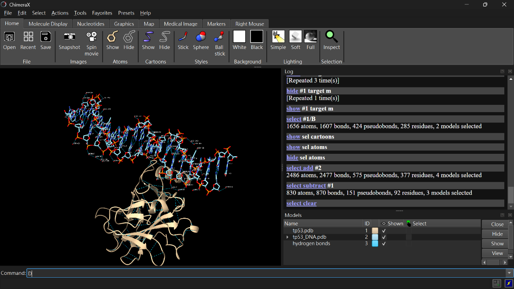

# Scientist’s Mission (0153B032, 林冠妤)

[https://github.com/kyuu719/0153B032-2-](https://github.com/kyuu719/0153B032-2-)

## Who Stole TP53’s Superpower? Searching for the Key to Unlock Cancer
### Using AI to Uncover the Secrets of TP53–DNA Interactions

---

### 1. 【The LEGO Assembly Line】

**What type of bond links amino acids together to form a protein? Which amino acids form hydrogen bonds with each other?**

**Answer:**
Amino acids are linked together by peptide bonds (strong covalent bonds between the carboxyl group of one amino acid and the amino group of the next).

In TP53 (3KMD), hydrogen bonds form between side chains like serine, threonine, glutamine, tyrosine, and arginine, as well as between backbone atoms. These hydrogen bonds stabilize the protein’s structure and help p53 bind DNA effectively.

---

### 2. 【The Double-Track Highway of Life’s Blueprint】

**How do nucleotides assemble to form double-stranded DNA? What are the basic structural components of DNA? Is DNA right-handed or left-handed? List the names of the four DNA bases. Which bases form hydrogen bonds with each other?**

**Answer:**
- **Assembly of DNA:** Nucleotides join through phosphodiester bonds (linking the sugar of one nucleotide to the phosphate of the next), forming a sugar–phosphate backbone. Two strands align in opposite directions and pair via hydrogen bonds.
- **Basic components:**
  - Sugar (deoxyribose)
  - Phosphate group
  - Nitrogenous base
- **Helix type:** Most DNA is right-handed (B-DNA form).
- **Four bases:** Adenine (A), Thymine (T), Cytosine (C), Guanine (G).
- **Base pairing:**
  - A pairs with T (2 hydrogen bonds)
  - C pairs with G (3 hydrogen bonds)

---

### 3. 【Searching for My One-and-Only Soulmate in the Universe: A 20-Base-Pair Love Code Hidden Among 3 Billion DNA Base Pairs】

**The source of molecular stability and specificity: hydrogen bonding — How do TP53 and DNA recognize each other?**
**Using the structure 3KMD, identify one pair of an amino acid and a DNA base that interact with each other.**

**Answer:**
In the TP53–DNA complex (structure 3KMD), recognition happens through specific hydrogen bonds between amino acid side chains and DNA bases.

👉 **A clear example:**
Arginine 248 (Arg248) from TP53 inserts into the DNA minor groove and forms hydrogen bonds with guanine bases.

This interaction is crucial because Arg248 is one of the "hotspot" residues often mutated in cancers. It stabilizes the protein–DNA complex by providing both molecular specificity (recognizing guanine) and stability (through hydrogen bonding).

So, one pair is: **Arginine 248 (protein) – Guanine (DNA base)**.

---

### 4. 【Return to the Crime Scene】

**Why can a mutation (change) in just one amino acid of a protein sometimes lead to a serious human disease? Give one specific example of such a disease.**

**Answer:**

---

### 5. 【Return to the Crime Scene: Searching for Clues】

**Using the TP53–DNA structure (3KMD), identify one TP53 amino acid mutation that can lead to uncontrolled cell division and contribute to the development of cancer.**
**Then examine this amino acid in ChimeraX. Based on its three-dimensional position, determine whether the mutated amino acid is located directly at the protein–DNA interface or somewhere else in the protein.**

**Answer:**

#### a. Paste a screenshot of your ChimeraX visualization here.

#### b. Save your ChimeraX session file as StudentID.cxs.
